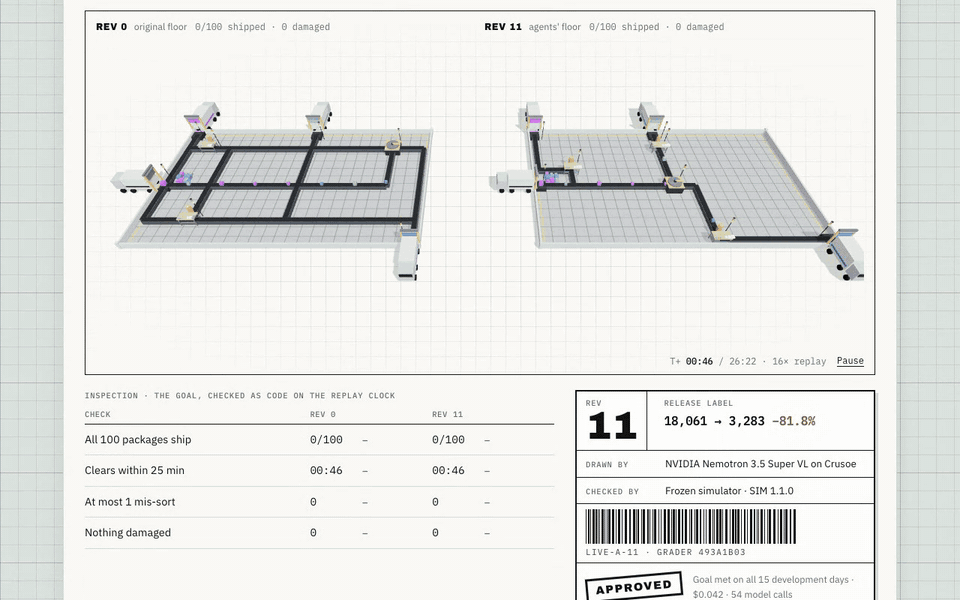
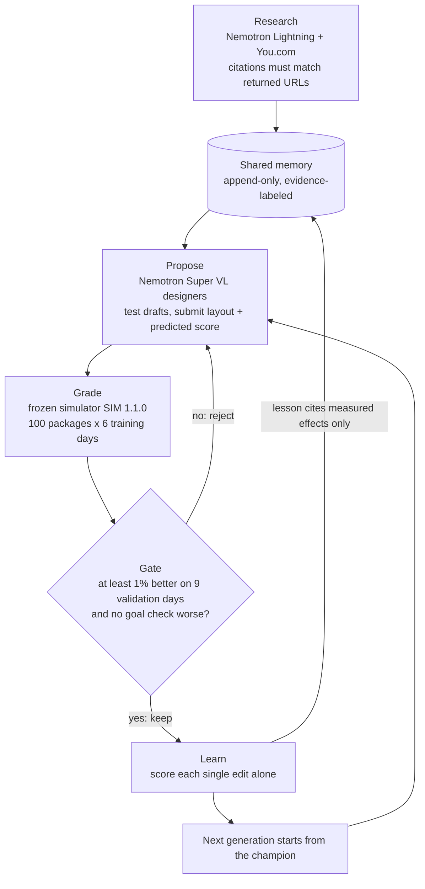
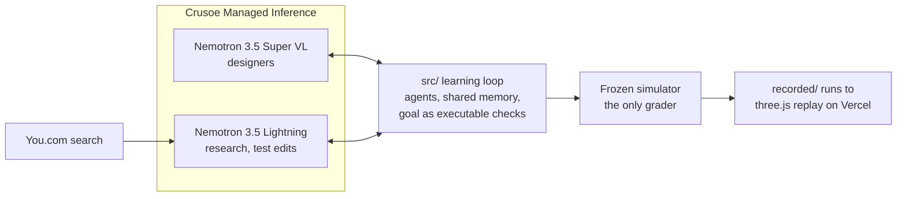
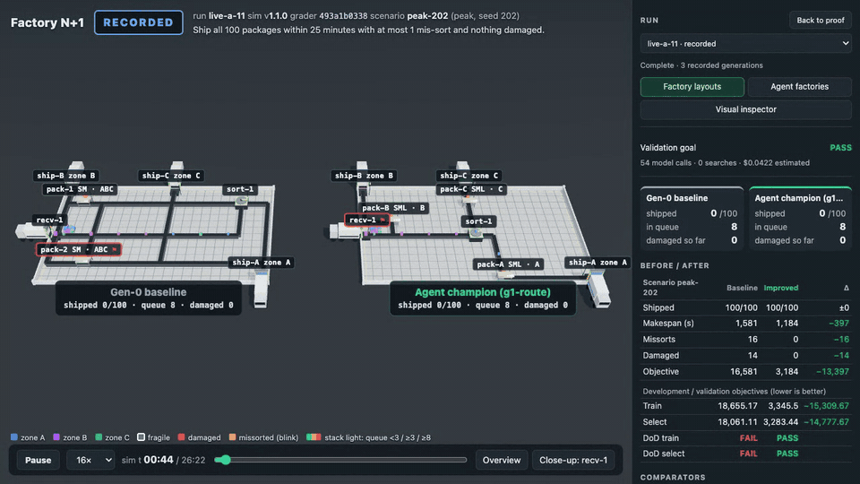
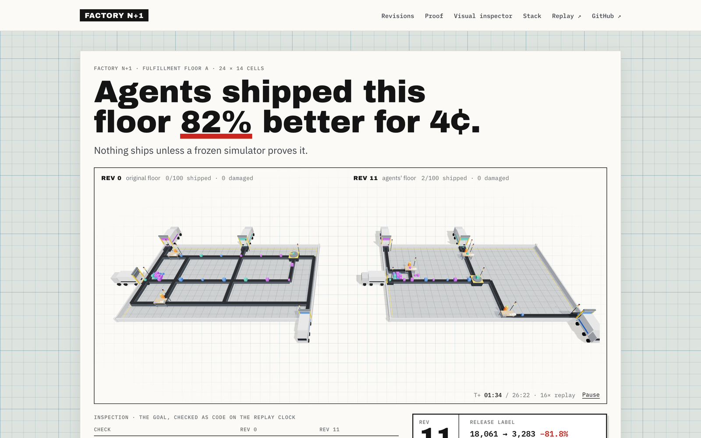
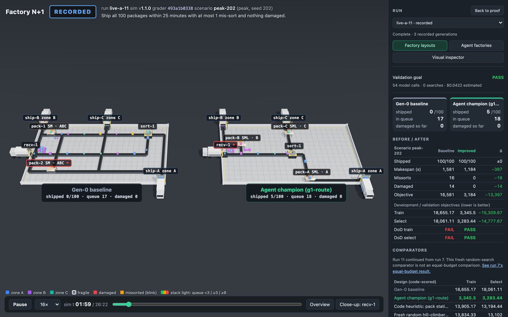

# Factory N+1

A team of **NVIDIA Nemotron** agents on **Crusoe Managed Inference** redesigns a parcel fulfillment floor (receive → sort → pack → ship, 100 packages). The agents research real practice with **You.com**, share what they learn in one memory, and test every change against a frozen simulator. A change is kept only if code measures it as better on days the designers never saw.

> **Status:** Hackathon project — Crusoe x Cerebral Valley **Recursive Agents Hackathon**, San Francisco, 2026-10-17. **Won NVIDIA Best Use of Nemotron.** Everything here was written during the event; the repo is kept as a reference build.

**Live site:** [factory-n1.vercel.app](https://factory-n1.vercel.app) · **3D replay:** [factory-n1.vercel.app/replay.html](https://factory-n1.vercel.app/replay.html) · **Demo video:** [youtu.be/rYMa50uhpzA](https://youtu.be/rYMa50uhpzA)



## Results (as submitted, 2026-10-17 13:50 PT)

| Question | Answer | Proof |
|---|---|---|
| Do the agents improve the floor? | **Yes, by 82%.** Validation score 18,061 → 3,283 (lower is better). At −66% (`live-a-7`) they already beat a one-line code fix (13,194) and random search with the same 41 simulator runs (13,099). | `live-a-7` re-scored independently by Codex; `live-a-11` re-scored from its saved layout |
| Did they reach the goal? | **Yes, on all 15 development days** (the final split stays locked): 100/100 shipped, 0 mis-sorts, 0 damaged, every day under 25 minutes. Three runs failed first because the designers mis-measured route lengths. With a ruler tool (`measure_legs`), one move of one pack station fixed it. | `live-a-11`: 54 calls, $0.042 ([why it took a ruler](docs/evidence/zero-damage-feasibility.md)) |
| Does shared memory help on new factories? | **No, it hurt.** Memory lost all 4 paired tests on two fresh factories (median score +2,357, worse). | [memory-eval-valid.md](docs/evidence/memory-eval-valid.md), n = 4 |
| Can the numbers be trusted? | One frozen grader (hash `493a1b03…`) scores everything. Agents never score themselves, and every claim they make is checked. | Replays regenerate exactly |
| What did it cost? | `live-a-7`: 61 model calls, $0.029. All runs: $0.355 inference plus $0.10 search; $0.886 counting uncertain reservations at their bound, inside a $2.00 ceiling. | [spend-accounting.json](docs/evidence/spend-accounting.json) |

## How it works

1. **Research.** Nemotron Lightning searches You.com. Every citation must match a URL the search actually returned. Ideas enter memory as untested hypotheses.
2. **Propose.** Nemotron Super VL designers read the shared memory, test drafts in the simulator, then submit a layout plus a predicted score through a typed tool.
3. **Grade.** A frozen simulator runs 100 packages on 6 training days and scores the result.
4. **Gate.** The change is kept only if it is at least 1% better on 9 separate validation days and no goal check gets worse.
5. **Learn.** Code splits each change into single edits and scores each one alone. The lesson written to memory cites only those measured effects.

The 3D viewer replays the exact scored runs: the baseline and the champion floor side by side, on one clock.

### The loop



The final 20-day test split stays locked. A supervisor stops or re-plans, and hard call and spend caps bound every run.

### Architecture



### See it



| Proof board | 3D replay |
|---|---|
| [](https://factory-n1.vercel.app) | [](https://factory-n1.vercel.app/replay.html) |

## The three tracks

| Track | What we built | Proof | Gap |
|---|---|---|---|
| **Version N+1** | Generation-by-generation ratchet, runs that continue from earlier runs, equal-budget comparisons | −66% on validation (`live-a-7`) | Most of the gain comes in generation 1; memory didn't transfer to new factories |
| **Done Means Done** | Goal written as executable checks ("all shipped" can't be removed), graded predictions, a supervisor that stops or re-plans, hard spend caps | The goal shows FAIL honestly; refuted predictions fell from 4 of 7 to 0 of 7 once designers tested their drafts | The goal is hand-written; a goal compiler is in progress |
| **Shared Brain** | Append-only memory every agent reads; each lesson labeled by its evidence (untested, tested, or observed in a kept change) | Crusoe prefix-cache hits up to 49% of prompt tokens | No quality gain on new factories (0 of 4) |

## Stack and sponsors

- **TypeScript / Node** for the simulator, agents and learning loop; **Vite + three.js** for the proof board and 3D replay; static deploy on **Vercel**.

- **Crusoe Managed Inference** serves every model call (about $0.0005 each) and caches the shared memory prompt across agents.
- **NVIDIA Nemotron:** 3.5 Super VL designs every layout through typed tool calls (8 of 8 valid in `live-a-5`); 3.5 Lightning runs research and builds test edits.
- **You.com** supplies the research, with exact-URL citation checks. No web idea improved the floor when tested on its own.

## What we learned

- **The model lied, and the grader caught it.** Lightning once invented a simulator re-run with made-up numbers.
- **Measure the edit, not the story.** Super VL credited a fix to the wrong change; per-edit scoring found the real cause.
- **Testing drafts makes agents honest.** Refuted predictions dropped from 4 of 7 to 0 of 7.
- **Memory can make agents worse.** Lessons tied to one factory's coordinates misled designers on new ones.

## Limits

- The simulator uses synthetic rules (for example, fragile packages break on legs over 12 cells). It is not calibrated to a real facility.
- Small n: seven runs on factory A ranged from −33% to −66%.
- The original factory agent's 20-day final test split remains locked. A separate Nemotron 8B critic fine-tuning pilot used its own disjoint synthetic test buildings; it did not change the frozen demo.

## Separate critic fine-tuning pilot

After Crusoe's native fine-tuning estimate failed on missing model/pricing metadata, we trained a LoRA adapter for a pinned Nemotron Nano 8B on one Crusoe A100. One epoch over 600 simulator-labeled examples took 216.455 seconds. Validation used 100 examples; a separate frozen test compared base and adapter on 100 examples from five unseen buildings under equal limits.

The adapter learned the output contract: exact-schema responses rose from 0/100 to 100/100. Prediction quality was not reliable: zero-damage accuracy on valid layouts was 18/75 (24%), below the 54.7% majority-label diagnostic, with 35 false-safe zero-damage outputs across all cases. We did not integrate this critic into the optimizer. The unchanged simulator remains the grader. See [pilot receipt](docs/evidence/nemotron-finetune-pilot.md) and [independent audit](docs/evidence/nemotron-8b-heldout-independent-audit.md).

## Run it

```bash
npm ci
npm test               # simulator, memory, full offline loop, 3D trace math
npm run web            # local site at http://localhost:5173, full 3D replay at /replay.html
npm run build:static   # static site in web/dist: viewer plus recorded runs, no server code or keys
```

A live run needs a Crusoe key, plus a You.com key for research. Load them from a secret mount, never a plaintext file, and set spend caps:

```bash
CALL_BUDGET=120 SPEND_CAP_USD=0.50 node --env-file=<path-to-secret-mount> --import tsx scripts/solve.ts 8 my-run 1
npm run publish-run -- my-run   # public copy in recorded/
```

## Where things are

| Path | What |
|---|---|
| `src/sim/` | Frozen simulator and grader (SIM 1.1.0) |
| `src/tasks/`, `layouts/` | Factories A–E with fixed docks, plus F and G for the memory test |
| `src/agents/`, `src/loop/` | Nemotron designers, reflector, the learning loop |
| `src/memory/` | Shared memory, You.com research, per-edit scoring |
| `src/llm/` | Crusoe client with spend caps and typed tool calls |
| `web/` | Landing proof board and the three.js replay of the scored runs |
| `recorded/` | Public copies of recorded runs |
| `docs/specs/factory-n1.md` | Full as-built spec: claims, proof, runs, work log |
| `docs/evidence/` | Run evidence, independent checks, spend, [commit hash map](docs/evidence/commit-hash-map.md) after the history rewrite |
| `docs/demo/script.md` | Demo script |

## Related

- Write-up and project page: [benjaminshyong.com](https://benjaminshyong.com)

## Credits

Built by [Ben Shyong](https://github.com/benikigai) with AI coding agents (Claude Code, Codex) during the event. Sponsors: Crusoe, NVIDIA, You.com; hosted by Cerebral Valley.
