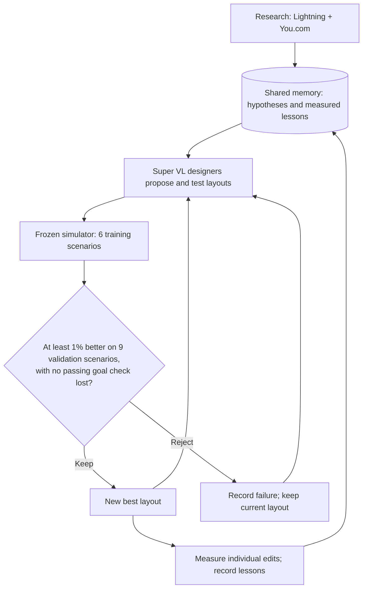

# Factory N+1

A parcel factory that AI agents can redesign. **NVIDIA Nemotron** agents on **Crusoe** research, propose and test layouts. A frozen simulator decides which changes survive.

**[Live demo](https://factory-n1.vercel.app)** · **[3D replay](https://factory-n1.vercel.app/replay.html?run=live-a-11)** · **[Full specification](docs/specs/factory-n1.md)**

Built at the Crusoe x Cerebral Valley Recursive Agents Hackathon, October 17, 2026.


## Results

| Measure | Original floor | Run 11 |
|---|---:|---:|
| Mean validation penalty | 18,061 | **3,283** |
| Packages shipped, displayed peak day | 100/100 | **100/100** |
| Completion time, displayed peak day | 26:21 | **19:44** |
| Mis-sorts, displayed peak day | 16 | **0** |
| Damaged packages, displayed peak day | 14 | **0** |

**81.8% lower penalty**, not 81.8% faster shipping. The score combines completion time, mis-sorts, damage, unshipped packages and equipment cost. Run 11 met the goal on all 15 development scenarios; its final test split remains locked.

Run 11 continued from run 7. Its accepted move shortened a damaging route from **15 cells to 11**. It used **54 model calls and $0.042 in recorded inference usage**, excluding earlier runs and training. [Measured fix](docs/evidence/zero-damage-feasibility.md) · [Independent re-score](docs/evidence/independent-verification-live-a-11.md)

For the equal-budget comparison, run 7 scored **6,083**, versus **13,194** for a simple code heuristic and **13,099** for random search, with the same 41 simulator evaluations. [Run 7 receipt](recorded/live-a-7/summary.json)

## How it improves



Each scenario contains 100 packages. Training uses two normal, two peak and two fragile-heavy days; validation uses three of each, with different fixed seeds. Validation feedback helps select revisions, so it is **not an untouched final test**.

The main loop changes layouts and later prompts, not model weights. Designers can inspect routes with `measure_legs` and test drafts with `simulate_layout`. Humans added the ruler and clarified placement rules before run 11; the agent selected the accepted move.

The viewer exposes recorded agents, proposals, tool receipts and simulator traces. It also runs local scenario previews. A recorded replay is distinct from a new live agent run.

| Proof board | Inspectable replay |
|---|---|
| [](https://factory-n1.vercel.app) | [](https://factory-n1.vercel.app/replay.html?run=live-a-11) |

<details>
<summary>Watch the recorded replay</summary>


</details>

## What the experiments proved

| Experiment | Result | Limit |
|---|---|---|
| [Shared memory transfer](docs/evidence/memory-eval-valid.md) | Memory lost all **4 paired tests** on two fresh factories. | This saved playbook did not generalize; small sample. |
| [Nemotron 8B critic](docs/evidence/nemotron-finetune-pilot.md) | Required-format responses improved **0/100 → 100/100**. | Recognized **0/17** goal-passing layouts. Format learning, not reliable prediction. |
| [Nemotron 8B optimizer](docs/evidence/nemotron-optimizer-pilot.md) | Penalty reduction on 20 unseen factories: **12.64% tuned**, **0.14% base**, **4.27% random**. | **21/60** tuned proposals invalid; **0/20** full-goal wins. |

The two 8B adapters are separate fine-tuning experiments. Neither produced the run 11 replay. The simulator uses synthetic rules and has not been calibrated to a real facility.

## Run locally

```bash
npm ci
npm test
npm run web          # landing at localhost:5173; replay at /replay.html
npm run build:static # static viewer and recordings in web/dist
```

New live runs require Crusoe credentials and, for research, You.com credentials. Use a secret mount and explicit spend caps. [Run instructions and architecture](docs/specs/factory-n1.md) · [Walkthrough](docs/demo/walkthrough.md) · [Spend records](docs/evidence/spend-accounting.json)
